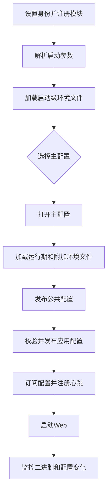
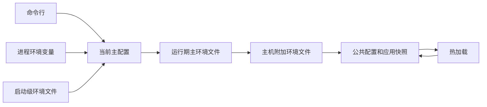
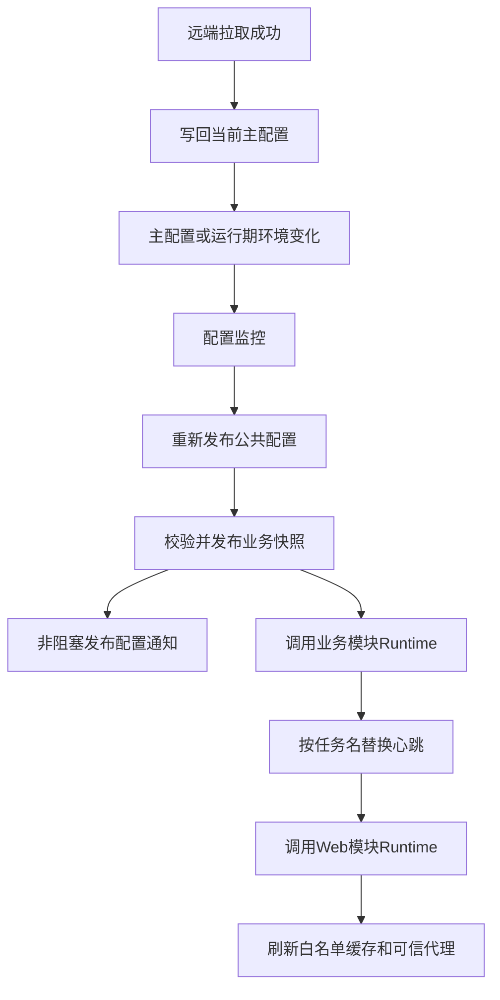
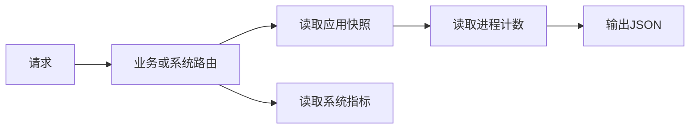

# pkgapp

`examples/pkgapp` 是可运行的 pkg 应用规范范本, 用于新项目搭建和旧项目迁移. 范本业务只演示 pkg 已有能力, 实际业务按项目需求实现.

## AI 提示词

```text
请先阅读 https://github.com/fufuok/pkg/blob/main/examples/pkgapp/README.md,
取得 examples/pkgapp 的完整内容, 包括 src、etc、env、两级 Makefile、
.golangci.yml 和 bin/log 目录占位文件. 缺失资料时说明影响, API 以所选 pkg 版本源码为准.

任务: <新建项目 / 迁移旧项目>; 项目目录: <路径>; 方案: <需求或链接>.
AppName: <项目名>; Go module: <模块路径>; BinName: <小写二进制名>;
DebName: <安装包名>. 迁移时未要求变更的项目身份和模块路径沿用现有值.

新建项目按范本布局落在项目根目录, 保留 src 为独立 Go module.
迁移旧项目先梳理入口、模块、配置和部署的对应关系, 再按模块调整, 不用范本覆盖现有业务和配置.
除方案明确要求外, 保持既有接口、协议、数据、配置及部署行为兼容.

系统基础代码沿用范本的目录、文件名、函数名、变量名和组织方式, 不自行改名或重组.
保留薄 main.go、conf 配置快照、模块 init.go 的 M/Start/Runtime/Stop 及 Web 的 api/sys 分层;
按需增删业务模块和字段, global.go 仅承载需跨文件共享的业务生命周期状态. 必要偏离说明原因和影响.
同步项目身份、module/import、配置和 env 文件名、MAIN_CONFIG_FILE、应用 env 前缀及 BIN_NAME.
src/Makefile 的 GO_MOD 保持 github.com/fufuok/pkg, 用于注入 pkg/config 的构建信息.

公共能力优先复用 pkg, 依赖选型遵循本文, 不另建同类配置框架或远端协议.
新项目使用 pkg 最新发布版本: go -C src get github.com/fufuok/pkg@latest.
旧项目先核对 Go、pkg 及相关直接依赖的兼容性, 再按方案升级, 不批量升级无关依赖.
Go 版本满足所选 pkg 的 go.mod 要求, 相关常用库的选型和版本跟随 pkg;
在实际模块目录执行 go mod tidy, 用 go.mod/go.sum 固定实际解析结果, 不提交本机 replace.

复用基础骨架, 删除无业务需要的演示接口、任务及其配置和校验; 注释只保留适用的机制与边界.
新项目按 pkg/tools 文档为 AppName 生成 BASE_SECRET_KEY, 不复制演示密文.
旧项目保留现有密钥和密文兼容, 变更 AppName 或密钥时同步处理重加密和兼容.
完成后按项目实际执行格式化、build、vet、lint、现有测试及运行验证,
覆盖实际接口、启停和保留的热加载能力. 项目 README 记录实际架构、配置和运行方式, 不照抄示例.
```

## 目录

```text
examples/pkgapp
├── README.md              本说明
├── Makefile               顶层入口, 转发到 src/Makefile
├── .golangci.yml          src 模块的 lint 配置
├── env
│   ├── pkgapp.default.env 启动级主配置选择, 只读一次
│   ├── pkgapp.env         运行期主环境变量
│   └── local.env          主机附加环境变量
├── etc
│   ├── pkgapp.json        默认主配置
│   └── local-pkgapp.json  启动级 env 当前选中的主配置
├── bin/.gitignore         保留目录, 忽略构建产物
├── log/.gitignore         保留目录, 忽略运行日志
└── src                    独立 Go module
    ├── Makefile           构建、dev、测试和 lint
    ├── main.go            项目身份和模块注册
    ├── conf               config.go、env.go、default.go、init.go
    ├── service            包级状态、定时任务、加密和签名
    └── web
        ├── init.go        Gin 引擎生命周期
        └── router
            ├── api        setup_router.go、v1_api.go
            └── sys        setup_router.go、runtime_stats.go
```

`bin/` 和 `log/` 只保留目录. 构建产物和 `pkgapp.log` 不提交.

## 代码规范

- `main.go` 只设置 `AppName`、`BinName`、`DebName`, 再注册模块. 不写业务逻辑.
- 每个模块用 `init.go` 定义 `M`, 并实现 `Start`、`Runtime`、`Stop`.
- 包级 `const` 紧跟 import, 包级 `var` 紧随其后, 同类集中声明.
- 只有跨文件共享且需要随生命周期启停的状态才进入 `global.go`.
- 应用配置使用 `atomic.Pointer[AppMainConf]`, 通过 `conf.App()` 读取; pkg 提供的通用程序配置通过 `conf.Main()` 读取. 返回对象只读, 不得直接修改.
- 路由文件只注册路径和处理请求, 不保存跨请求可变状态.
- 业务逻辑留在应用模块, 公共能力复用 pkg. 配置和模块错误返回给 pkg/master 处理, 请求错误就地返回 HTTP 状态, 不增加无需求的通用框架.
- 导入 `github.com/fufuok/pkg/json` 时包名保持 `json`.
- Go 版本和常用三方库跟随下方「依赖选型」, 不另选同类库.

## 依赖选型

新项目使用 pkg 最新发布版本, Go 版本至少满足该版本 `go.mod` 的要求. 常用三方库的选型和相关依赖版本跟随所选 pkg 的 `go.mod`, 只引入实际需要的库; 下表列出对应能力, 不另选同类库. 旧项目迁移先核对兼容性, 只调整本次迁移涉及的依赖. `go.mod` 和 `go.sum` 记录实际解析的版本, 升级后重新验证.

| 能力 | 使用 pkg 已采用的库 | 不另选 |
| --- | --- | --- |
| Web | `github.com/gin-gonic/gin` 或 `github.com/gofiber/fiber/v3` | 不引入 Echo、chi、net/http router |
| JSON | `github.com/fufuok/pkg/json` | 不直接引入 `encoding/json`、json-iterator 或其他 JSON 库 |
| 日志 | `github.com/fufuok/pkg/logger` | 不引入 zap、logrus、slog 包装 |
| HTTP 客户端 | `github.com/imroc/req/v3` | 不引入 resty 或其他客户端框架 |
| Redis | `github.com/redis/go-redis/v9` | 不使用 v8 或其他 Redis 客户端 |
| 定时任务 | `github.com/fufuok/pkg/crontab` | 不直接创建另一套 cron |
| 协程池 | `github.com/fufuok/ants` | 不引入其他 worker pool |
| 缓存 | `github.com/fufuok/cache`、`github.com/fufuok/freelru` | 不引入 ristretto、bigcache 等同类库 |
| 环境变量 | `github.com/joho/godotenv` | 不引入另一套 env 解析器 |
| 系统指标 | `github.com/fufuok/pkg/stats`, 非 Linux 基础采集使用 pkg 已采用的 `gopsutil/v3` | 不另建采集器或混用其他采集库 |
| 命令执行 | `github.com/go-cmd/cmd` | 不直接散落 `exec.Command` 包装 |
| 原生 SQL 助手 | `github.com/fufuok/pkg/sqldb` | SQL、驱动、连接池和 schema 由应用管理 |

pkg 已经封装的能力优先调用 pkg. 只有 pkg 没有对应封装时, 才直接依赖上表中的库.

使用 `database/sql` 的业务仓储可按需调用 `WithTx`、`WithTxValue`、`ForEach` 和 `Collect`, 参见 [sqldb 使用契约](../../sqldb/README.md) 和 [独立 SQLite 演示](../sqldb/README.md). 使用前将项目的 pkg 依赖升级到 v1.3.11 或更新版本. 本范本不配置数据库; 应用持有连接池并在退出时关闭, 既有 GORM 项目继续使用其事务和查询能力.

本范本直接依赖已发布的 pkg, 不使用本地 `replace`. pkg 的 Gin 引擎默认启用 `ContextWithFallback`, `gin.Context` 的取消、超时和上下文值可回退到 `Request.Context`; 应用无需重复设置.

## 启动流程



注册顺序是依赖顺序: `conf` 在 `ConfigStage`, `service` 然后 `web` 在 `MainStage`. pkg 会自动把 `config.M`、`common.M` 放在配置阶段最前, 把 `crontab.M` 放在主阶段最前, 应用不要重复注册.

## 配置机制



只保留三个 env 文件:

1. `pkgapp.default.env`: 启动时加载一次, 只填补进程中尚未设置的变量, 不热加载.
2. `pkgapp.env`: 主配置打开后加载, 覆盖同名进程环境变量, 支持热加载.
3. `local.env`: 由 `sys_conf.env_files` 在主 env 后加载. 数组中后加载的文件覆盖前面的同名变量; 相对路径基于 `env/`.

主配置选择的优先级是: 命令行 `-c` 或显式 `config.ConfigFile` > `MAIN_CONFIG_FILE` > `MAIN_CONFIG_NAME` > `etc/{BinName}.json`. `MAIN_CONFIG_FILE` 的相对路径基于 `etc/`, 绝对路径直接使用; `MAIN_CONFIG_NAME` 只取文件名并补齐 `.json`. 启动级文件中的同名值不会覆盖已有进程环境.

运行期 env 文件缺失时忽略, 其他读取或解析错误会拒绝本次公共配置加载. 上轮由这些文件管理、本轮从全部运行期 env 文件中删除或注释的变量会被置空, 不恢复启动前的进程值.

未显式指定路径时, 主配置、运行期 env 和日志的默认文件名由 `main.go` 的 `config.BinName` 派生. 本示例是 `pkgapp`, 对应 `etc/pkgapp.json`、`env/pkgapp.env` 和 `log/pkgapp.log`; `-c` 和 `log_conf.file` 等显式配置可以覆盖默认路径.

`LOCAL_BIN_NAME` 在运行期 env 加载时覆盖身份变量 `BinName`. 此前 `RootPath`、`ConfigFile`、`EnvMainFile` 和 `LogFile` 等路径已经派生, 不会随该变量重新计算. 新项目在 `main.go` 固定身份并同步命名交付文件; 主配置选择使用 `-c`、`MAIN_CONFIG_FILE` 或 `MAIN_CONFIG_NAME`, 不依赖身份变量改名来切换路径.

`PKGAPP_MESSAGE` 由应用侧 `conf.loadEnvConfig` 读取. pkg 重载 env 文件后只更新进程环境, 不会调用应用同名函数; `conf.Start` 和 `conf.Runtime` 负责刷新应用变量. 非空值覆盖 `app_conf.message`, 最终消息为空时返回配置错误: 启动失败退出, 热加载失败由 pkg 记录错误. `PKGAPP_NOTE` 演示内部密文 env 的解密和热加载, `/v1/status` 只返回 `note_configured`, 不输出明文.

`PKGAPP_PAYLOAD_KEY` 使用内部配置密文保存对外 AES-GCM 的密钥: 用 `crypto/rand` 生成 32 字节, 以 `base64.RawURLEncoding` 编码后再用 `Encrypt` 包装. 配置阶段解包、解码并校验长度, 再交给 `SealString` / `OpenString`. `WEB_SIGN_KEY` 也使用内部配置密文, 由 pkg 解密到 `WebConf.SignKey`, 与业务消息和加密密钥独立.

`xcrypto.Seal` / `Open` 是可对外交互的标准通用加密. `xcrypto.Encrypt`、`Decrypt`、`GetenvDecrypt` 是 pkg 和程序内部使用的确定性配置包装, 不提供密文认证; 解密非空不保证密钥或原文正确. 两者不互换.

在没有外部环境覆盖或 `-c` 参数时, 启动级文件的 `MAIN_CONFIG_FILE=local-pkgapp.json` 使程序加载 `etc/local-pkgapp.json`, 监听 `127.0.0.1:18081`. `MAIN_CONFIG_FILE` 和 `MAIN_CONFIG_NAME` 都为空时回退 `etc/pkgapp.json`.

真实部署中 `pkgapp.default.env` 和 `local.env` 建议不进 Git, 由运维一次性部署. 本示例的这两个文件进 Git, 用于直接运行.

示例 JSON 和 env 只给出推荐的基本配置. 完整配置项以 pkg 的 `config.MainConf` 和当前项目的 `conf.AppMainConf` 为准.

pkg 与应用配置都优先读取非空的 `config.AppConfigBody`, 为空时才读取当前主配置文件. 本范本未设置该变量. 应用只解析 `app_conf`, 公共字段由 pkg 解析, 不在应用结构中重复定义.

## 热加载与远端配置



`main_conf.method` 使用 pkg 已注册的 `GetDataSource`. 默认 `api` 为空、`interval` 为 0, 不启用远端拉取. 启用时填写 `api` 并将 `interval` 设为至少 30 秒, 数据源遵循 pkg 的 [GetDataSource 协议](https://github.com/fufuok/pkg/blob/main/config/remote.go), 返回的配置正文需为完整主配置 JSON. 示例不覆盖该方法, 也不实现远端接口. pkg 忽略 JSON 中的 `main_conf.path`, 固定写回当前选中的主配置, 再走同一条热加载链路.

`secret_name` 一旦填写, 对应环境变量必须解密出非空值, 否则本次公共配置加载失败. `sys_conf.skip_remote_config` 由 pkg 按进程工作目录检查. 本示例约定从 pkgapp 项目根启动, 配置 `env/skip_remote_config.lock`, 创建该文件即可跳过拉取. 从其他工作目录启动时, 将锁文件配置为绝对路径. `-p` 指定派生配置、env 和日志目录所用的 bin 目录, 不改变进程工作目录; 使用时指定绝对 bin 目录.

watcher 按注册顺序调用模块 `Runtime`, 更新心跳和可热更的 Web 配置. pubsub 通知只供 service 记录观察次数, 不驱动这条重载流程. 通知 channel 容量为 1, 连续更新时通知可能被丢弃; `generation` 表示 service 观察到的配置通知次数, 不是配置成功发布总次数. 最新业务配置始终读取 `conf.App()`.

## 请求路径



默认本地配置的入口是 `http://127.0.0.1:18081`:

- `/ping`: pkg Gin 系统路由.
- `/v1/status`: 当前消息、心跳次数、观察到的配置通知次数、主配置路径和 `note_configured`.
- `POST /v1/echo`: 接收 `message` 和 `sign`, 用 `VerifySignTTL` 校验后以 `SealString` 加密, 返回 `secret` 和新的时间签名 `sign`.
- `POST /v1/open`: 接收 `secret` 和 `sign`, 校验后用 `OpenString` 还原 `message`.
- `/sys/check`: Gin 解析后的客户端 IP.
- `/sys/stats/pwd~~/ok`: 运行状态.
- `/sys/stats/pwd~~/ok/desc`: pkg 指标说明.

运行状态按 `SYS`、`METRIC`、`NETWORK`、`WEB` 和示例 `APP` 分组. `METRIC` 直接使用 `MetricStats()`, 已包含 `Main`、`Memory` 和 `Scheduler`; `/desc` 对应 pkg 的四组指标说明. `SYS`、`METRIC.Main` 和 `NETWORK` 的操作系统字段各自最多每 30 秒按访问刷新, 没有后台采集; 应用时间和 Go 运行时字段仍实时读取. CPU 是两次成功读取之间的均值, 首次采样不代表实时负载. `NumConnections` 是未采集占位 0, 不代表实际零连接; 采集失败结合 `ResourceErrors` 或 `Errors` 判断, 不支持的扩展字段正常省略.

`NETWORK` 直接使用可选的 `NetworkStats()`, 展示主机网络命名空间的累计计数, 不代表当前进程独占流量或速率. Linux 提供接口、IPv4 UDP 和 IPv4/IPv6 合计 TCP 计数; 非 Linux 只提供支持的接口计数. 范本只展示原始值, 指标含义见 `/desc`.

`/sys/stats` 的后续路径完全由 `web_conf.stats_path` 决定, 可以热加载修改. 例如配置 `/pwd~~/ok`, 则请求 `/sys/stats/pwd~~/ok`; 空值或不匹配返回 404. 这相当于简单路径密码, 知道路径即可访问.

示例默认只监听 loopback. 复制后若把监听地址改成 `0.0.0.0` 并允许公网访问, 继续使用公开的示例路径, 外部用户即可请求统计接口并看到主机、进程和配置路径等信息. 公网部署至少改成私有且难猜的路径并使用 HTTPS; URL 仍可能留在代理或访问日志中. 需要更严格访问控制时再使用 pkg 现有白名单或鉴权能力.

客户端用签名密钥的明文调用 `xsign.GenSignNow` 生成 `sign`. 服务端 env 的 `WEB_SIGN_KEY` 保存内部包装密文, pkg 解密到 `WebConf.SignKey`, 接口结合 `SignTTL` 校验. `xsign` 只认证时间令牌, 不绑定请求正文, 不阻止有效期内重放; AES-GCM 认证密文完整性. 示例只展示 pkg 原始能力的组合, 真实业务根据协议补充正文签名或重放约束.

## 不可热更边界

- `pkgapp.default.env`、命令行 `-c` 和主配置文件选择需要重启.
- `web_conf.server_addr`、TLS 地址和路由注册需要重启.
- `Start` 和 `Stop` 每个进程各执行一次, `Runtime` 可多次执行. Web 启动失败由 `engine.Run` 退出程序.
- `engine.Run` 不暴露关闭接口, 本范本 Web `Stop` 为空操作, 随进程退出释放监听. 待 pkg 提供关闭能力后再同步范本.
- 公共配置由 pkg 先发布, 应用配置校验成功后再替换业务快照, 校验失败保留旧业务快照. pkg 记录 `Runtime` 错误后仍会继续后续模块, 不回滚已发布的公共配置; `conf.Main()` 和 `conf.App()` 不保证同时切换.

## 运行与复制

所有启动命令均从 pkgapp 项目根执行, 避免锁文件等相对配置随工作目录变化. 顶层 `Makefile` 只转发到 `src/Makefile`, 后者完成检查和构建后返回项目根启动. 在 Git Bash / WSL2 中执行 `make dev`: 它会格式化、vet、包编译检查和 lint, 然后以 `etc/local-pkgapp.json` 和 `-debug` 启动. `GO_BIN` 和 `LINT_BIN` 可在命令行覆盖, 如 `make dev GO_BIN=go LINT_BIN=golangci-lint`. 独立验证可在本目录执行:

```shell
gofumpt -l -w src
go -C src vet ./...
go -C src build ./...
make lint
```

Windows PowerShell 没有 make 时, 从 pkgapp 项目根执行以下命令完成同样的检查、构建和启动:

```powershell
gofumpt -l -w src
go -C src vet ./...
go -C src build ./...
Push-Location src
golangci-lint run -c ../.golangci.yml --timeout 15m --modules-download-mode=readonly ./...
Pop-Location
go -C src build -o ../bin/pkgapp.exe .
bin/pkgapp.exe
```

启动后请求 `/ping`、`/v1/status` 和统计路径. 另开终端将下面代码保存为临时 `verify.py` (UTF-8), 再执行 `python verify.py`, 验证后删除. 该方式可用于 Git Bash、WSL2 和 Windows PowerShell, 只需要 Python 3 标准库. `key` 是签名密钥的明文; 未替换范本密钥时使用下面的公开演示值, 新项目须同步替换 `base`、`key` 和消息.

```python
import hashlib, json, time, urllib.request

base = "http://127.0.0.1:18081"
key = "pkgapp-demo-sign-key"
ts = str(int(time.time()))
# 与 xsign.GenSignNow 的时间令牌格式一致, 不包含正文.
sign = ts + hashlib.md5((ts + key).encode()).hexdigest()

def post(path, value):
    """发送一次本地验证请求, HTTP 错误直接终止验证."""
    req = urllib.request.Request(base + path, json.dumps(value).encode(),
                                 {"Content-Type": "application/json"})
    with urllib.request.urlopen(req, timeout=5) as response:
        return json.load(response)

sealed = post("/v1/echo", {"message": "hello pkgapp", "sign": sign})
opened = post("/v1/open", sealed)
assert opened["message"] == "hello pkgapp", opened
print(opened)
```

启动日志出现 `Watching` 后, 修改 `env/pkgapp.env` 的 `PKGAPP_MESSAGE`, 等待 watcher 重新加载后确认状态变化; `local.env` 如配置同名变量会继续覆盖主 env. 最后按 Ctrl+C 确认生命周期退出. 范本不保留测试文件, pkg 通用能力的回归测试放在 pkg 对应包, 应用特有边界按实际业务验证.

复制时按开头提示词同步项目身份及文件, 在新项目根执行以下命令取得 pkg 最新发布版本, 并按该版本 `go.mod` 对齐 Go 和需要直接依赖的常用三方库:

```shell
go -C src get github.com/fufuok/pkg@latest
go -C src mod tidy
```

### 敏感信息加密

新项目需要生成自己的基础密钥 `BASE_SECRET_KEY`, 操作步骤和示例见 pkg 的 [环境变量加密工具](https://github.com/fufuok/pkg/blob/main/tools/README.md). 工具的 `-appname` 必须与新项目 `main.go` 的 `AppName` 一致.

其他敏感配置按业务需要设置. 例如启用接口签名时, 按工具文档的「通用敏感信息加密」示例, 将变量名替换为 `WEB_SIGN_KEY`: 工具先从 `BASE_SECRET_KEY` 解出基础密钥原文, 再用它加密签名密钥; 将输出的密文写入 `env/{BinName}.env`. 客户端使用签名密钥明文, 服务端 env 保存密文.

当前范本保留了签名加解密演示接口, 因此 `WEB_SIGN_KEY` 和 `PKGAPP_PAYLOAD_KEY` 仍须配置, `PKGAPP_NOTE` 可以留空. 复制为新项目时按业务保留或删除这些接口及其配置、校验; 保留的敏感配置须使用新基础密钥重新加密, 不沿用演示密文.
